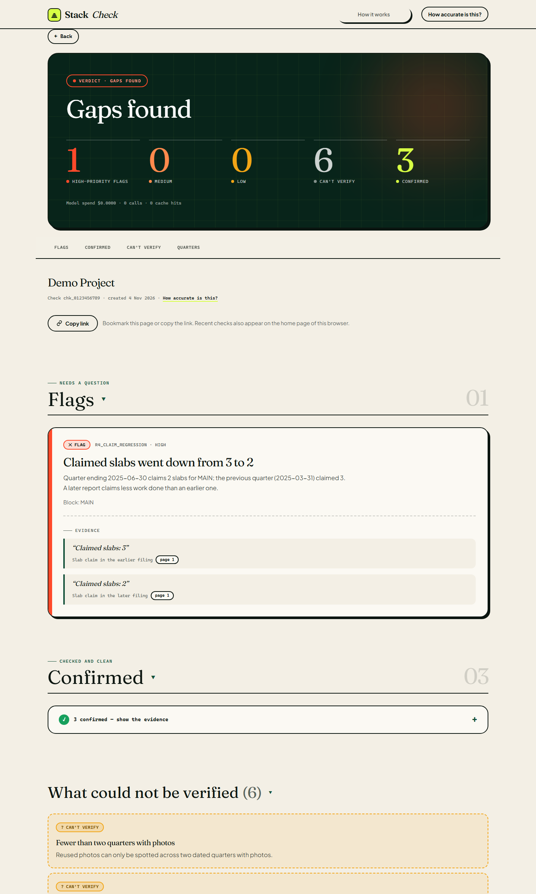
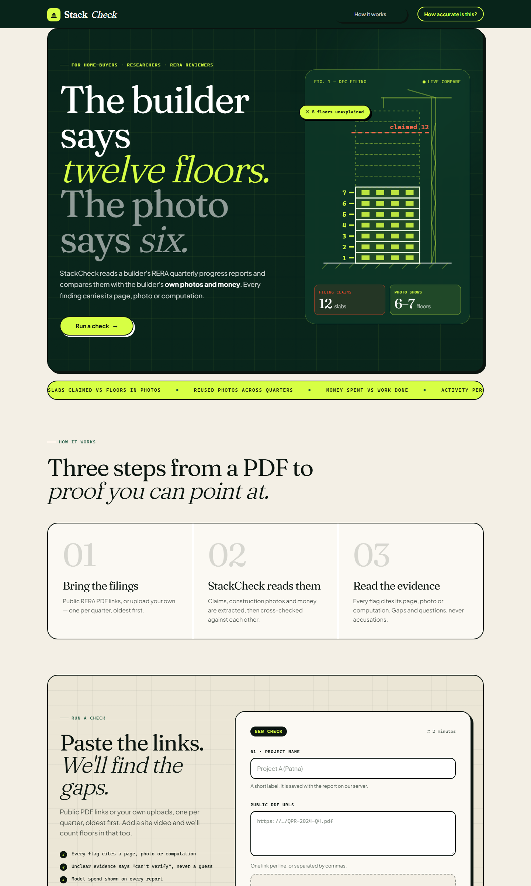
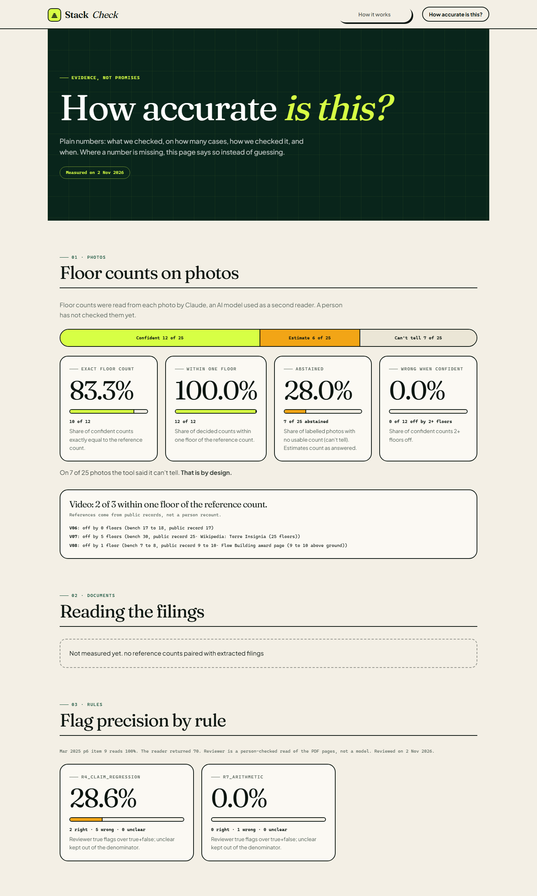
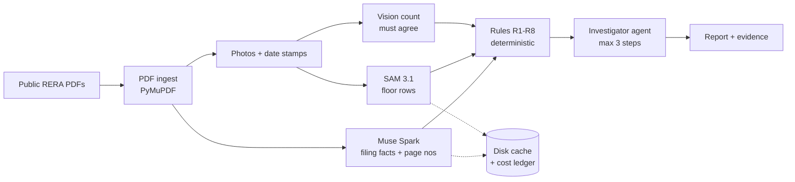

# StackCheck

Builders file quarterly progress reports with photos. StackCheck checks the builder's own photos and money against the builder's own claims — and says "can't verify" when the evidence isn't clear.

[](https://rushabhtrivedi03--stackcheck-web.us-east.modal.run)



    

**Live demo:** https://rushabhtrivedi03--stackcheck-web.us-east.modal.run (first load can take a few seconds while the server wakes up). Track: Indie. Theme: Build for Your World. Built during the hackathon, Oct 28 to Nov 4, 2026.

## Problem

In India you pay for a flat years before it exists. Every quarter, the builder files a public progress report with RERA — slab counts, money in and out, dated site photos. Nobody checks those reports against each other, so a claim that contradicts the builder's own photos sits in a public PDF, unread.

## What it does

Paste a project's RERA report links, press Check, get a report where every finding carries its evidence: the page, the photo, the computation.

- **Photo vs claim** — visible floors in elevation photos against claimed slabs
- **Reused photo** — the same photo filed in two different quarters
- **Photo date** — whether site photos sit inside the filing window
- **Progress vs plan** — activity percentages against sanctioned floors
- **Copy-paste quarter** — identical money figures two quarters running
- **Money vs progress** — spending running ahead of work done
- **Arithmetic** — cumulative figures that don't add up across quarters
- **Missing evidence** — claims with no photo or money to check them against

The demo moment: a red card says "gap found", the builder's own photo shows numbered floor rows drawn by StackCheck, and the card links to the filing page with the claim. When the evidence isn't clear, StackCheck says "can't verify" instead of guessing, and the agent trace shows every step it tried.

## Screenshots

| Report (a gap found) | Start (paste links, press Check) | Accuracy (measured, not claimed) |
|---|---|---|
|  |  |  |

## How it works

Filings are public PDFs fetched one at a time from the RERA portal. PyMuPDF extracts text and embedded photos; Muse Spark reads the filings into structured facts with page numbers and reads the date stamps on photos. SAM 3.1 finds window, balcony and opening rows in elevation photos to count visible floors, and a separate vision count must agree before a count is trusted.

A bounded agent investigates unclear photo findings (at most 3 steps: another photo, another SAM prompt, a crop), but only the deterministic rules set a finding's status. All model calls go through a disk cache and a cost ledger, so re-running a check costs close to nothing.

## Meta models used and how

- **Muse Spark 1.3** — reads filings into structured facts; contributor tier for public filings, standard tier for anything a user uploads (uploads never touch contributor models).
- **SAM 3.1** — floor-row detection on elevation photos (Meta API only).
- **Muse Spark Open** — the reading step on Baseten (`meta-models/muse-spark-open-1026`, the default) with Fireworks as the measured fallback.
- **Muse Code** — built this repo during the hackathon.

## Architecture



## Tools and stack

| Layer | Technology | Why |
|---|---|---|
| API | FastAPI + Uvicorn | Async endpoints serving the Svelte app and the check pipeline |
| Reading | Muse Spark 1.3 / Muse Spark Open (Baseten, Fireworks fallback) | Filings into structured facts with page numbers |
| Vision | SAM 3.1 + vision count | Two independent floor counts that must agree |
| PDF + images | PyMuPDF, Pillow, NumPy | Text/photo extraction, overlays, hashing |
| Frontend | Svelte 5, Vite, TypeScript | Start, report and accuracy views |
| Deploy | Modal (Debian slim, Python 3.13, one warm container, data Volume) | Public demo URL |
| Data | Pydantic v2 models, JSON files | Every shape that crosses a module boundary |

Dependency versions are exactly those in `pyproject.toml` and `web/package.json`.

## Measured results (Oct 28 – Nov 2, 2026)

Full table in `docs/kpi_snapshot.md`, refreshed by `scripts/kpi_report.py`:

- Filing extraction: 99.1% of fields correct (113/114) against 4 hand-labelled filings.
- Photo facts: kind right on 29/30 photos (96.7%), storey counts 5/5; no unambiguous date-stamp case, so that score is no-data by design.
- Floor counting on 25 openly licensed benchmark photos: 48% confident counts (100% within 1 floor, 0% confidently wrong), 24% estimates, 28% can't-tell.
- Providers on the same filings: Meta 98.2% at $0.0015/filing, Baseten 99.1% at $0.0454, Fireworks 99.1% at $0.0547 — Baseten became the default.
- Cost per project check: at most $0.2750 observed.

## Run it yourself

```bash
uv sync
uv run pytest -q
uv run uvicorn stackcheck.api.app:create_app --factory --port 8000
```

Then `cd web && npm install && npm run dev`. Needs keys in `.env` for the providers you use (`MODEL_API_KEY`, `BASETEN_API_KEY`, `FIREWORKS_API_KEY`); unit tests use fakes and need none.

## Features

- [x] Check a project from public RERA PDF links, end to end
- [x] Rules R1–R8 with page/photo/computation evidence on every finding
- [x] "Can't verify" abstention plus investigator agent trace
- [x] Accuracy page showing the measured eval numbers
- [x] Disk cache + cost ledger on every model call
- [ ] Hand-verified sample FLAG on the live site
- [ ] Real multi-quarter project checked end to end

## Challenges

- Floor counting says can't-tell on 28% of hard benchmark photos (plus 24% estimates) — hard cases stay honest abstentions.
- No unambiguous stamped photo in the labelled set, so the date score is empty.
- Tuned and measured on Bihar QPR layouts; other states' formats are untested.

## What's next

- Hand-verify the first real FLAG and publish it as a sample report.
- Run the first real multi-quarter project end to end.
- Measure investigator-agent recovery on real buildings.
- Try other states' RERA formats beyond Bihar.

## Data and legal

- Only public RERA filings, fetched one at a time from the allow-listed portal. No scraping, no logins.
- Never committed: PDFs, photos or overlays from filings, `.env`, ledgers. The repo holds synthetic test images plus 25 Wikimedia Commons benchmark photos with attribution in `data/bench/ATTRIBUTION.md`.
- Wording: "gap found", "doesn't match", "can't verify". A gap is a question to ask the builder or RERA, not proof of wrongdoing.
- PyMuPDF is AGPL-3.0 licensed. This repo is AGPL-3.0-or-later (see `pyproject.toml`).

## Links

- Live demo: https://rushabhtrivedi03--stackcheck-web.us-east.modal.run
- Measured KPIs: `docs/kpi_snapshot.md`
- Benchmark attribution: `data/bench/ATTRIBUTION.md`
